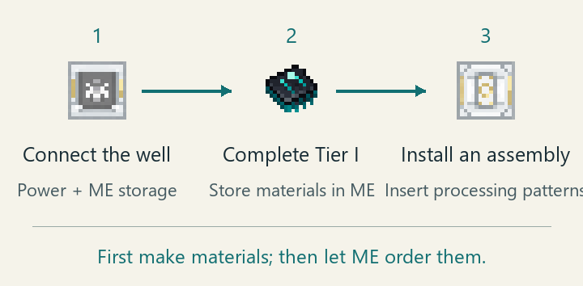
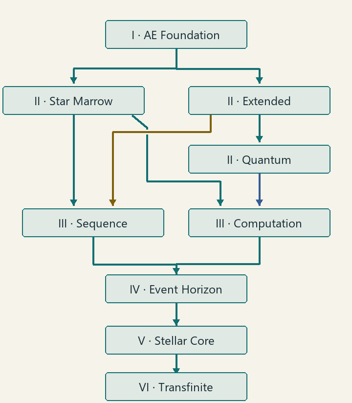

# OmniSequence: Transfinite

[简体中文](README.zh-CN.md) · [Configuration](docs/README.md#configuration--配置) · [API reference](docs/README.md)

An AE2 and ExtendedAE expansion for automated bases. Research and process materials in a Matter Fabrication Well, manage recipes and stock with Sequence devices, and run large crafting jobs with computation cores. A Star Orrery speeds up machines on the same network. A Singularity Hub collects resources and copies items.

Hover over an item in your inventory or JEI and press the AE2 guide key (**G** by default). You can change the key in Controls. The guide is available in English and Simplified Chinese.

## Install

OmniSequence **21.3.0.5** runs on **Minecraft 1.21.1 / NeoForge** with **Java 21**. [Download the mod JAR](https://www.curseforge.com/minecraft/mc-mods/omnisequence-transfinite)

| Required component | Version for this branch |
| --- | --- |
| NeoForge | 21.1.220 or later |
| AE2 | Loader minimum 19.2.17. Reference build 19.2.18. |
| ExtendedAE | 1.21-2.2.32-neoforge or later |
| LDLib2 | 2.2.18 or later |
| AppliedEnhancements | 1.1.2 or later |

Put OmniSequence, the required mods and their dependencies in `mods/`. ExtendedAE needs Glodium (reference build 1.21-2.2-neoforge). Use matching builds on the client and server for multiplayer.

Use **JEI** to check recipes, structures and material lists. Install **AdvancedAE** to complete the default six-tier progression, starting with Quantum Materials.

Check JEI and the well's Research tab for your modpack's recipes and costs. The mod ID is `molecularmanipulator`.

<details>
<summary>Optional-mod compatibility</summary>

- Install Neo ECO AE Extension **21.2.19 or later** with **LDLib2 2.2.40 or later** on both client and server.
- AdvancedAE starts at **1.6.11**. Reaction Chamber and Quantum Crafter recipe permissions target **1.6.12-1.21.1** specifically.
- ExtendedAE Plus **1.6.4.1** adds automatic provider selection and well uploads.
- ExpandedAE **2.1.1** conflicts with OmniSequence's Pattern Provider changes.

[Integration reference](docs/README.md)

</details>

## Build your first automated well



You need a powered **ME network** first: AE2 cables, item storage and a terminal. Research takes materials from that network, not from your backpack. Automatic material ordering additionally needs crafting patterns, ingredients and an available crafting CPU.

1. **Make a Matter Fabrication Well controller with basic AE2 materials.** No star research is required. Reserve **41×41 blocks, 27 blocks tall**. Open the controller, enable **Projection**, check the material list and use **Build** with materials in your inventory or connected ME storage. JEI shows the full structure.
2. **Connect ME and power.** Check that the structure is formed and the network is online. Install item/fluid ports for initial manual processing; use the guide to find their service positions.
3. **Complete Tier I, AE Foundation.** Open **Research**, select the branch and put its listed materials into ME. Start when ready, or use **Order** to prepare missing materials. The first completion unlocks AE processing, the Pattern Assembly and the Sequence Auto Crafter.
4. **Add a Pattern Assembly.** Encode the well's processing recipes and put the patterns in the assembly to accept ME crafting jobs. Uploading from JEI uses one blank pattern from the encoding terminal or its ME network. Leave space for the output. The well controller uses one AE2 channel for the whole well.
5. Complete Tier II materials research to open the Sequence and Computation branches.

### Research route



| Step | What it opens |
| --- | --- |
| I: AE Foundation | Basic AE processes, Pattern Assembly, Auto Crafter |
| II: Star Marrow / Extended / Quantum Materials | Materials for later devices; Quantum requires AdvancedAE |
| III: Sequence Engineering / Computation Architecture | Sequence devices and crafting-CPU structures |
| IV → V → VI: Event Horizon → Stellar Cores → Transfinite Integration | Hole devices and hub structure, then hub controller, then Compute Nexus |

Each parent normally needs **one completion**. Machine-integration research is different: **both Tier III branches must each have three total completions**, including the first unlock round. It imports another machine's supported recipes into the well; the curated Tier II material recipes are not subject to that three-round gate.

Each built-in research has **nine rounds**. The first unlocks recipes; later rounds increase how many copies of those recipes can run in one batch. Materials, power and output space still limit the actual batch. A normal order prepares the next round; **Shift-order** prepares all remaining rounds and completes them in one research run. Preparation can be canceled, but ordered research cannot be stopped or paused after it starts.

Two optional branches are available: **Exotic Matter Studies** after Tier I unlocks Ghost Matter and Gravity Crystals; **Star Signal-Induced Crystallization** after Star Marrow Materials grows crystals using water and Star Signal Flow while retaining its Flawless parent-rock catalyst. Production speed comes from a same-network Star Computation Engine, not extra research rounds. Built-in fabrication recipes normally take 20 seconds before that speed bonus; research has its own timer.

### Grow Star Marrow crystals

Turn a Primordial Crystal Core into a seed at the Twin Singularity Observation Ring in the End. Use seeds to convert ExtendedAE's entroized Fluix parent rock. Crystal growth can wear the rock down to a Star Marrow Crystal Block. Mine a Flawed rock yourself during a Simulation Lantern session to get Flawless rock. [Star Marrow guide](src/main/resources/assets/molecularmanipulator/ae2guide/items-blocks-machines/star_marrow_crystals.md)

## Choosing a device

| I want to… | Use this |
| --- | --- |
| Research or process materials | **Matter Fabrication Well**; add a **Pattern Assembly** for ME autocrafting |
| Store many patterns and keep several products stocked | **Sequence Array**: large pattern library and nine independent restocking positions |
| Connect machines wirelessly across dimensions | **Sequence Wireless Hub** |
| Batch crafting, smithing or stonecutting in one block | **Molecular Sequence Rewrite Array**: 360 pattern slots; requires Single-Block Integration as well as well research |
| Add batch execution to an ExtendedAE Assembler Matrix | **Assembler Matrix Sequence Rewrite Core** |
| Maintain a product target while reserving ingredients | **Sequence Auto Crafter** |
| Run several ME crafting orders at once | **Omni Computation Core**: works without a Star Computation Engine. Orders on one core share its crafting storage and ingredient dispatch limit. |
| Fit a crafting CPU into one block | **Transfinite Compute Nexus**: one channel, substantial ME power and both research requirements |
| Speed up the same ME network | **Star Computation Engine**, built as the **Nine-Ring Star Orrery** |
| Produce Star Signal Flow | **Star Sea Calculation Mainframe**, with a Star Signal Storage Cell |
| Collect many raw resources or copy a sample | **Event Horizon Singularity Hub**; **Compact Hub** is a creative/command alternative |
| Transport dropped items or non-player creatures | **Miniature Black Hole / White Hole**: nearest same-team exit |
| Walk on walls and ceilings or build lifts | **Gravity Crystal**; **Ghost Matter** is water-suppressed hazardous material and a retained catalyst |
| Get Flawless Star Marrow Parent Rock | **Simulation Lantern** |

On a Sequence Array, **Auto upload** receives newly encoded crafting, smithing and stonecutting patterns from native AE2 terminals on the same network. It starts **off**. **Migrate patterns** is a one-click move of existing physical patterns from public slots and online storage cells. Processing patterns stay at their source; full-library leftovers stay there too. Existing pattern items and their components are preserved.

To feed a smelting factory in batches, point a standard AE2 Pattern Provider at the side that accepts ore. A processing pattern with one ingredient can send several crafts together. A pattern with different ingredients still sends complete recipes one at a time. If the machine fills up, check the provider for ingredients waiting to go in.

## Sequence Wireless Hub

Craft a hub with an AE2 Quantum Link Chamber surrounded by eight Quantum Rings. No research is needed. Connect the hub to ME with a cable. It can link machines across dimensions at any distance.

1. Remove the receiver's external ME cables and any singularity in its quantum slot.
2. Open **Remote connection**, select a same-team hub and click **Connect selected hub**.

Check the link status in the same panel. Click **Disconnect** to remove the binding. Supported receivers include Matter Fabrication Wells, Sequence Arrays, Molecular Sequence Rewrite Arrays, Sequence Auto Crafters, Star Computation Engines, multiblock Omni Computation Cores and both Singularity Hub variants. Fabrication ports and Pattern Assemblies manage the well controller's binding.

The hub draws **64 AE/t** plus **512 AE/t** per link. Receivers still use their usual power and channels. The hub provides 32 channels by default, depending on AE2 settings. Keep both ends loaded. Without FTB Teams, links belong to the player who placed the blocks.

With an AE2 Memory Card, sneak-right-click the hub and then right-click the receiver to bind it. Sneak-right-click the receiver with the selected card to unbind. Rebind receivers after moving or replacing the hub. Empty-hand right-click shows the hub's status and link count. [Wireless Hub guide](src/main/resources/assets/molecularmanipulator/ae2guide/items-blocks-machines/sequence_array_controller.md)

## Nine-Ring Star Orrery

L0 needs the complete central body and foundation.

- The **27-block central body**: 1 core, 22 casing and 4 observation ports, one at the center of each horizontal face.
- The **928-block foundation**: 520 engraved and 408 gilded blocks in their prescribed positions.

Use JEI's **Star Orrery Structure** preview or order a complete **L1/L2/L3 package**. Every package includes the full center and foundation, plus its first 1/2/3 rings: **979/1011/1051 blocks** total. The core is 37 blocks above the package's selected base.

Open **Upgrade** and supply the anchors shown. Existing correctly placed anchors count; only missing anchors are taken, inventory first and then the same powered ME network. L1/L2/L3 use **24/56/96 cumulative Reference anchors**. Levels L4 to L9 must be upgraded in order. Defaults add **no separate upgrade energy, quest or research payment**, and completing one level does not start the next. Missing inner rings lower the usable level; stacking engines does not multiply the speed bonus.

At **actual L3**, open **Recipe Tree**, select **Single-Block Integration** and click **Unlock**. This is the only default star research. It costs **0 bits** and has no prerequisite. The engine must be formed, ME-online and bound to your team.

This permanent team permission restricts only the **Molecular Sequence Rewrite Array** and **Transfinite Compute Nexus** recipes by default. Each still needs its own well research and materials. The **Well, Sequence Array and Omni Computation multiblock controllers have no default star-research lock**. Custom packs may add more rules. Existing paid research remains saved; see the [star-research reference](docs/star-research-nodes.zh-CN.md) for stable IDs and migration.

### Produce Star Signal Flow

Place a **Star Sea Calculation Mainframe** on a level 5×5 foundation with 9 clear blocks above it. Connect ME at the **white socket at the bottom front center**, provide one channel and install a **Star Signal Storage Cell** in ME storage. It works at night in ordinary non-fixed-time skylit dimensions, or in the Detached Signal Realm; all 25 positions immediately above its roof must have light **7 or less**. Empty-hand right-click shows what is blocking it.

Defaults are **128 bits for 1024 AE per operating local tick**. The Detached Signal Realm gives **8× output at the same per-tick cost**; its changing time speed separately affects work per real second. Star Signal Flow powers optional overclocking and crystal proliferation. The free L3 research does not need a signal balance.

Craft the **Star Signal Storage Cell** with this layout.

| Left | Center | Right |
| --- | --- | --- |
| Vibrant Quartz Glass | Star Marrow Crystal Dust | Vibrant Quartz Glass |
| Star Marrow Crystal Dust | Star Signal Storage Component | Star Marrow Crystal Dust |
| Star Marrow Alloy Ingot | Star Chart Processor | Star Marrow Alloy Ingot |

## Build and move whole machines

|  |  |  |
| --- | --- | --- |
| **Package:** carries a complete building | **Calibrator:** previews and unfolds it | **Access Terminal:** opens an already built machine remotely |

1. Connect a **Spatial Folding Assembler** to ME. Its seven complete packages appear as craftable products in the ME terminal: Well, Sequence Array, Omni Computation Core, Singularity Hub and Orrery L1/L2/L3. Request one with ME autocrafting. The order still costs the controller and all standard materials and respects their research requirements.
2. Right-click a site with the **Star Chart Calibrator**. Select the package, base and facing; inspect the projection for conflicts, then confirm. For a Singularity Hub reserve **97×97 blocks, 129 blocks tall**; its controller is 65 blocks above the base. Required empty light-well positions must also stay clear.
3. **Esc only closes the panel.** Right-click to reopen the same pinned site; use **Cancel point** to choose another. Withdraw unfinished construction with **Interrupt and reclaim building**, not sneak-right-click.
4. To relocate a working multiblock, use its machine screen's reclaim control after construction/upgrades and external ME crafting jobs have settled. This includes Wells, Arrays, multiblock computation cores, multiblock Hubs and formed Orreries. Stop hub collection before requesting reclaim; reclaim docks the moving parts. An Orrery archive package reflects its actual consecutive physical rings, including L0 and L4 to L9.

**Back up the whole world.** Building contents live in `<world>/data/molecularmanipulator/buildings/`; the package holds a reference, so copying only the item into another save does not copy the building. An old archive restores its original contents, not free missing parts. Old engine cubes need the complete central body and real Orrery foundation before they can form.

The **Building Access Terminal** binds up to 64 buildings. It works in the same dimension only while the target chunks are already loaded; it does not load them. Full deployment and reclaim instructions are in the G guide.

## Collection, copying and common checks

A Hub collects **1000 of each listed resource every 20 ticks** by default. On its duplication page, up to **64 miniature black holes** each generate **20 mB of Sequence Matter every 20 ticks**. Each mB costs **1000 FE or 256 AE**. Copying one item uses **1000 mB**, retaining the sample. Provide **ME fluid space** for matter and **ME item space** for products; storage capacity does not supply energy.

Black/white holes bind to the placer's FTB team, or the individual without FTB Teams. Re-place them after changing teams. White holes keep their chunks loaded; black holes need loaded chunks to work.

| Symptom | Check first |
| --- | --- |
| Structure will not form | Projection, missing/misplaced blocks, obstructions and loaded chunks |
| Research will not start | Materials in the well's ME storage, required completions, power and pending refunds |
| Recipe says research is required | Its well branch; for the two single-block devices, also manually unlock L3 Single-Block Integration |
| Production stops | Network power/channel, ingredients, catalyst and output capacity |
| Large effects reduce frame rate | Machine **Effects** button: 0 off, 1 reduced, 2 full; Shift-click restores your client default |

## Settings and author reference

Players can keep the defaults. Server owners can change power, pattern capacity, collection lists, production and chunk loading in `config/omnisequence-transfinite-server.toml`; rendering detail uses `config/omnisequence-transfinite-client.toml`. These are instance-wide files, outside per-world `serverconfig/`. Save and restart after editing. The [configuration reference](docs/README.md#configuration--配置) lists the fields and examples.

Modpack and mod authors can use [docs/README.md](docs/README.md) for recipe and research formats, KubeJS examples, team recipe permissions, Orrery upgrade rules and Java provider contracts.

### Build from source

Use Java 21 and prepare the local build dependencies. [Dependency setup](libs/README.md)

```sh
./gradlew build apiJavadoc
```

On Windows, use `gradlew.bat build apiJavadoc`. The runtime JAR is `build/libs/omnisequence-transfinite-21.3.0.5.jar`; Java API documentation is generated under `build/docs/api/`.

[MIT code license](LICENSE) · [Third-party notices](THIRD_PARTY_NOTICES.md)
