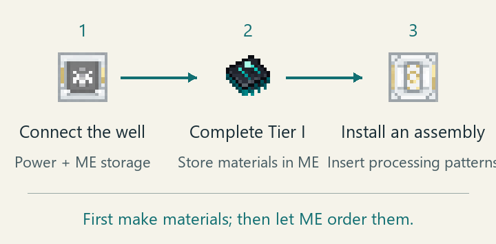
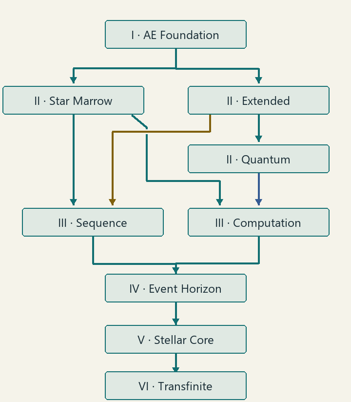

# OmniSequence: Transfinite

[简体中文](README.zh-CN.md) · [Configuration](CONFIGURATION.md) · [Author / API reference](docs/README.md)

An AE2 and ExtendedAE expansion for a growing automated base. Use the **Matter Fabrication Well** to research and process materials, **Sequence devices** to manage recipes and keep stock, and **computation cores** to run large crafting jobs. Later, a **Star Orrery** speeds up the network and a **Singularity Hub** collects resources and copies items.

**New player?** Install the dependencies below, build your first well, then follow the in-game guide. Hover an item in your inventory or JEI and press the AE2 guide key, default **G**; associated blocks also open their guide pages. If G does nothing, check the guide binding in **Options → Controls**. The guide is available in English and Simplified Chinese.

## Install

This branch is **21.3.0.0** for **Minecraft 1.21.1 / NeoForge**, using **Java 21**. Get the matching mod JAR from the [project page](https://www.curseforge.com/minecraft/mc-mods/omnisequence-transfinite); a source ZIP is not an installable mod.

| Required component | Version for this branch |
| --- | --- |
| NeoForge | 21.1.220 or later |
| AE2 | 19.2.18 reference version |
| ExtendedAE | 1.21-2.2.32-neoforge or later |
| LDLib2 | 2.2.18 or later |
| AppliedEnhancements | 1.1.2 or later; installed separately |

1. Set up a Minecraft 1.21.1 NeoForge instance with Java 21.
2. Put OmniSequence and the required mods in that instance's `mods/` folder. Install their own dependencies too, including ExtendedAE's Glodium.
3. For multiplayer, install matching builds on **both client and server**. Launch the game and check that the mods loaded.
4. **JEI is recommended** for recipes, structure previews and material lists. **AdvancedAE is optional to launch, but needed for the default Quantum Materials, Computation and later research branches.** Install it if you want the full six-tier progression.

Recipes and costs below describe the defaults. Your modpack's JEI pages, research requirements and machine status show its current rules. The internal mod ID, used by scripts and commands, is `molecularmanipulator`.

<details>
<summary>Optional-mod compatibility</summary>

- Neo ECO AE Extension: optional; 21.2.10 or later when installed, matching on both sides.
- AdvancedAE: loader minimum 1.6.11; the recipe-permission adapters for its Reaction Chamber and Quantum Crafter target **1.6.12-1.21.1 only**.
- ExtendedAE Plus: additional provider-selection and well-upload hooks target **1.6.4.1 only**.
- Data Energistics: the Digital Storage Depot capacity-simulation fix targets **3.3.0 and 3.3.5 only**; it does not enlarge storage.
- ExpandedAE **2.1.1 is incompatible** because of a conflicting pattern-provider modification.

The [author reference](docs/README.md) describes the version-specific integration contracts. These optional mods are not all required to play.

</details>

## From a new network to your first automated well



You need a powered **ME network** first: AE2 cables, item storage and a terminal. Research takes materials from that network, not from your backpack. Automatic material ordering additionally needs crafting patterns, ingredients and an available crafting CPU.

1. **Make a Matter Fabrication Well controller with basic AE2 materials.** No star research is required. Reserve **41×41 blocks, 27 blocks tall**. Open the controller, enable **Projection**, check the material list and use **Build** with materials in your inventory or connected ME storage. JEI shows the full structure.
2. **Connect ME and power.** Check that the structure is formed and the network is online. Install item/fluid ports for initial manual processing; use the guide to find their service positions.
3. **Complete Tier I: AE Foundation.** Open **Research**, select the branch and put its listed materials into ME. Start when ready, or use **Order** to prepare missing materials automatically. The first completion unlocks AE processing, the Pattern Assembly and the Molecular Auto Crafter.
4. **Add a Pattern Assembly.** Encode the well's processing recipes and place their patterns in the assembly to accept ME crafting jobs. A JEI well-recipe upload uses one blank pattern from the encoding terminal, or its connected ME storage if the local slot is empty. Keep output storage available.
5. **Choose your next project** from the table below. Expand materials through Tier II, then unlock the Sequence and Computation branches. You do not need to finish all nine rounds before moving to the next tier.

### Research route



| Step | What it opens |
| --- | --- |
| I — AE Foundation | Basic AE processes, Pattern Assembly, Auto Crafter |
| II — Star Marrow / Extended / Quantum Materials | Materials for later devices; Quantum requires AdvancedAE |
| III — Sequence Engineering / Computation Architecture | Sequence devices and crafting-CPU structures |
| IV → V → VI — Event Horizon → Stellar Cores → Transfinite Integration | Hole devices and hub structure, then hub controller, then Compute Nexus |

Each parent normally needs **one completion**. Machine-integration research is different: **both Tier III branches must each have three total completions**, including the first unlock round. It imports another machine's supported recipes into the well; the curated Tier II material recipes are not subject to that three-round gate.

Each built-in research has **nine rounds**. The first unlocks recipes; later rounds increase how many copies of those recipes can run in one batch. Materials, power and output space still limit the actual batch. A normal order prepares the next round; **Shift-order** prepares all remaining rounds and completes them in one research run. Preparation can be canceled, but ordered research cannot be stopped or paused after it starts.

Two optional branches are available: **Exotic Matter Studies** after Tier I unlocks Ghost Matter and Gravity Crystals; **Star Signal-Induced Crystallization** after Star Marrow Materials grows crystals using water and Star Signal Flow while retaining its Flawless parent-rock catalyst. Production speed comes from a same-network Star Computation Engine, not extra research rounds. Built-in fabrication recipes normally take 20 seconds before that speed bonus; research has its own timer.

## Which device solves my problem?

| I want to… | Use this |
| --- | --- |
| Research or process materials | **Matter Fabrication Well**; add a **Pattern Assembly** for ME autocrafting |
| Store many patterns and keep several products stocked | **Sequence Array**: large pattern library and nine independent restocking positions |
| Batch crafting, smithing or stonecutting in one block | **Molecular Sequence Rewrite Array**: 360 pattern slots; requires Single-Block Integration as well as well research |
| Add batch execution to an ExtendedAE Assembler Matrix | **Assembler Matrix Sequence Rewrite Core** |
| Maintain a product target while reserving ingredients | **Molecular Auto Crafter** |
| Run large ME crafting jobs | **Omni Computation Core**; high star levels enable concurrent requests |
| Fit a crafting CPU into one block | **Transfinite Compute Nexus**: one channel, substantial ME power and both research requirements |
| Speed up the same ME network | **Star Computation Engine**, built as the **Nine-Ring Star Orrery** |
| Produce Star Signal Flow | **Star Sea Calculation Mainframe**, with a Star Signal Storage Cell |
| Collect many raw resources or copy a sample | **Event Horizon Singularity Hub**; **Compact Hub** is a creative/command alternative |
| Transport dropped items or non-player creatures | **Miniature Black Hole / White Hole**: nearest same-team exit |
| Walk on walls and ceilings or build lifts | **Gravity Crystal**; **Ghost Matter** is water-suppressed hazardous material and a retained catalyst |
| Carry green light and obtain flawless parent rock in a personal simulation | **Simulation Lantern** |

On a Sequence Array, **Auto upload** receives newly encoded crafting, smithing and stonecutting patterns from native AE2 terminals on the same network. It starts **off**. **Migrate patterns** is a one-click move of existing physical patterns from public slots and online storage cells. Processing patterns stay at their source; full-library leftovers stay there too. Existing pattern items and their components are preserved.

## Star Orrery: speed first, single-block permission at L3

The engine is **not a standalone 3×3×3 machine**. Even L0 needs both:

- The **27-block central body**: 1 core, 22 casing and 4 observation ports, one at the center of each horizontal face.
- The **928-block foundation**: 520 engraved and 408 gilded blocks in their prescribed positions.

Use JEI's **Star Orrery Structure** preview or order a complete **L1/L2/L3 package**. Every package includes the full center and foundation, plus its first 1/2/3 rings: **979/1011/1051 blocks** total. The core is 37 blocks above the package's selected base.

Open **Upgrade** and supply the anchors shown. Existing correctly placed anchors count; only missing anchors are taken, inventory first and then the same powered ME network. L1/L2/L3 use **24/56/96 cumulative Reference anchors**. L4–L9 must be upgraded in order. Defaults add **no separate upgrade energy, quest or research payment**, and completing one level does not start the next. Missing inner rings lower the usable level; stacking engines does not multiply the speed bonus.

At **actual L3**, open **Recipe Tree**, select **Single-Block Integration** and **click Unlock**. It is the **only default star research**, costs **0 bits**, and has **no prerequisite**. Free does not mean automatic. The engine must be formed, ME-online and bound to your team.

This permanent team permission restricts only the **Molecular Sequence Rewrite Array** and **Transfinite Compute Nexus** recipes by default. Each still needs its own well research and materials. The **Well, Sequence Array and Omni Computation multiblock controllers have no default star-research lock**. Custom packs may add more rules. Existing paid research remains saved; see the [star-research reference](docs/star-research-nodes.zh-CN.md) for stable IDs and migration.

### Need Star Signal Flow?

Place a **Star Sea Calculation Mainframe** on a level 5×5 foundation with 9 clear blocks above it. Connect ME at the **white socket at the bottom front center**, provide one channel and install a **Star Signal Storage Cell** in ME storage. It works at night in ordinary non-fixed-time skylit dimensions, or in the Detached Signal Realm; all 25 positions immediately above its roof must have light **7 or less**. Empty-hand right-click shows what is blocking it.

Defaults are **128 bits for 1024 AE per operating local tick**. The Detached Signal Realm gives **8× output at the same per-tick cost**; its changing time speed separately affects work per real second. Star Signal Flow powers optional overclocking and crystal proliferation. The free L3 research does not need a signal balance.

The **Storage Cell** is a shaped crafting recipe, not the same item as its internal **Storage Component**:

| Left | Center | Right |
| --- | --- | --- |
| Vibrant Quartz Glass | Star Marrow Crystal Dust | Vibrant Quartz Glass |
| Star Marrow Crystal Dust | Star Signal Storage Component | Star Marrow Crystal Dust |
| Star Marrow Alloy Ingot | Star Chart Processor | Star Marrow Alloy Ingot |

## Build and move whole machines

These are the actual in-game item icons:

|  |  |  |
| --- | --- | --- |
| **Package:** carries a complete building | **Calibrator:** previews and unfolds it | **Access Terminal:** opens an already built machine remotely |

1. Connect a **Spatial Folding Assembler** to ME. Its seven complete packages appear as craftable products in the ME terminal: Well, Sequence Array, Omni Computation Core, Singularity Hub and Orrery L1/L2/L3. Request one with ME autocrafting. The order still costs the controller and all standard materials and respects their research requirements.
2. Right-click a site with the **Star Chart Calibrator**. Select the package, base and facing; inspect the projection for conflicts, then confirm. For a Singularity Hub reserve **97×97 blocks, 129 blocks tall**; its controller is 65 blocks above the base. Required empty light-well positions must also stay clear.
3. **Esc only closes the panel.** Right-click to reopen the same pinned site; use **Cancel point** to choose another. Withdraw unfinished construction with **Interrupt and reclaim building**, not sneak-right-click.
4. To relocate a working multiblock, use its machine screen's reclaim control after construction/upgrades and external ME crafting jobs have settled. This includes Wells, Arrays, multiblock computation cores, multiblock Hubs and formed Orreries. A Hub must stop collection and dock its moving parts first. An Orrery archive package reflects its actual consecutive physical rings, including L0 and L4–L9.

**Back up the whole world.** Building contents live in `<world>/data/molecularmanipulator/buildings/`; the package holds a reference, so copying only the item into another save does not copy the building. An old archive restores its original contents, not free missing parts. Old engine cubes need the complete central body and real Orrery foundation before they can form.

The **Building Access Terminal** binds up to 64 buildings. It works in the same dimension only while the target chunks are already loaded; it does not load them. Full deployment and reclaim instructions are in the G guide.

## Collection, copying and common checks

A Hub collects **1000 of each listed resource every 20 ticks** by default. On its duplication page, up to **64 miniature black holes** each generate **20 mB of Sequence Matter every 20 ticks**. Each mB costs **1000 FE or 256 AE**. Copying one item uses **1000 mB**, retaining the sample. Provide **ME fluid space** for matter and **ME item space** for products; storage capacity does not supply energy.

Black/white holes bind to the placer's FTB team, or the individual without FTB Teams. Re-place them after changing teams. White holes keep their chunks loaded; black holes need loaded chunks to work.

| Symptom | Check first |
| --- | --- |
| Structure will not form | Projection, missing/misplaced blocks, obstructions and loaded chunks |
| Research will not start | Materials in the well's ME storage, required completions, power and pending refunds |
| Recipe says research is required | Its well branch; for the two single-block devices, also manually unlock L3 Single-Block Integration |
| Production stops | Network power/channel, ingredients, catalyst and output capacity |
| Large effects reduce frame rate | Machine **Effects** button: 0 off, 1 reduced, 2 full; Shift-click restores your client default |

## Settings and author reference

Players can normally keep the defaults. Server owners can change power, pattern capacity, collection lists, production and chunk loading in `config/omnisequence-transfinite-server.toml`; rendering detail uses `config/omnisequence-transfinite-client.toml`. These are instance-wide files, not per-world `serverconfig/`. Save and restart after editing. See [Configuration](CONFIGURATION.md).

**Modpack and mod authors:** [docs/README.md](docs/README.md) links to recipe/research schemas, KubeJS examples, global recipe permissions, Orrery upgrade rules and Java provider contracts. Players do not need to implement those interfaces.

### Build from source — developers

Use Java 21 and prepare the local dependencies described in [libs/README.md](libs/README.md), including `appliedenhancements-1.1.4.jar` and the optional compile-time API JARs. Then run:

```sh
./gradlew build apiJavadoc
```

On Windows, use `gradlew.bat build apiJavadoc`. The runtime JAR is `build/libs/omnisequence-transfinite-21.3.0.0.jar`; Java API documentation is generated under `build/docs/api/`.

The GUI uses the default Minecraft font; no font files are bundled. Code is licensed under the [MIT License](LICENSE), and the adapted AE2 texture retains CC BY-NC-SA 3.0; see [Third-Party Notices](THIRD_PARTY_NOTICES.md).
