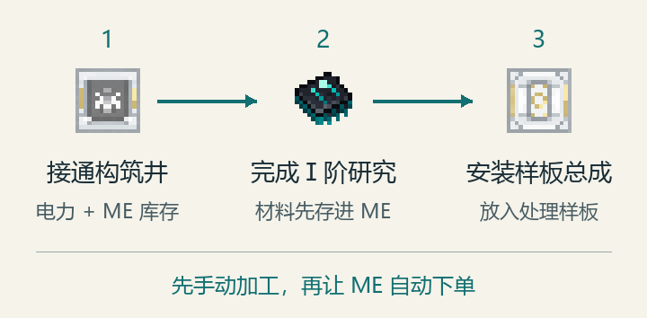
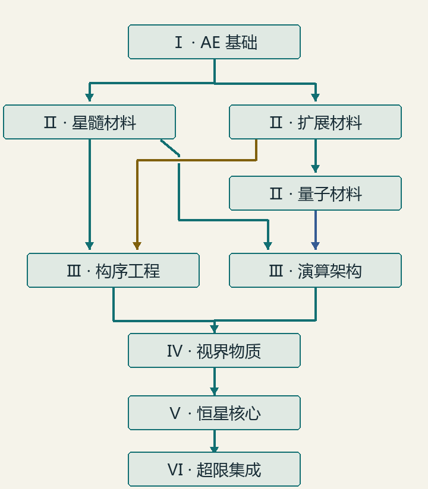

# 万象构序：超限 / OmniSequence: Transfinite

[English](README.md) · [配置参考](docs/README.md#configuration--配置) · [API 文档](docs/README.md)

这是一个用于扩建 AE2、ExtendedAE 自动化基地的附属模组。物质构筑井负责研究和加工材料，构序设备管理配方与库存，演算核心承接大型合成任务。后期可建造九环天体仪加速同网设备，用视界奇点天枢采集资源、复制物品。

在背包或 JEI 中把鼠标移到物品上，按 **G** 打开 AE2 指南。可在控制设置里改键。指南支持简体中文和英文。

## 安装

万象构序 **21.3.0.5** 适用于 **Minecraft 1.21.1 / NeoForge**，需要 **Java 21**。[下载模组 JAR](https://www.curseforge.com/minecraft/mc-mods/omnisequence-transfinite)

| 必需组件 | 本分支对应版本 |
| --- | --- |
| NeoForge | 21.1.220 或更高 |
| AE2 | 加载下限 19.2.17，参考 19.2.18 |
| ExtendedAE | 1.21-2.2.32-neoforge 或更高 |
| LDLib2 | 2.2.18 或更高 |
| AppliedEnhancements | 1.1.2 或更高 |

将本模组、表中的组件及其依赖放进 `mods/`。ExtendedAE 需要 Glodium（参考 1.21-2.2-neoforge）。联机时客户端和服务端使用相同的模组构建。

推荐用 **JEI** 查配方、结构和材料。推进默认主线的量子材料工程及后续研究时需要 **AdvancedAE**。

整合包可能调整配方和费用，实际要求可在 JEI 和研究页查看。模组 ID 为 `molecularmanipulator`。

<details>
<summary>可选模组兼容版本</summary>

- 安装 Neo ECO AE Extension **21.3.0** 或更高版本时，两端都要装 **LDLib2 2.2.40** 或更高版本。
- AdvancedAE 从 **1.6.11** 起支持加载。反应室和量子合成器的配方权限适配 **1.6.12-1.21.1**。
- ExtendedAE Plus **1.6.4.1** 支持自动选择供应器和构筑井上传联动。
- ExpandedAE **2.1.1** 的样板供应器修改会与本模组冲突。

[联动版本参考](docs/README.md)

</details>

## 搭建第一座自动加工井



先准备一套有电的 **ME 网络**：AE2 电缆、物品存储和终端。研究从这套网络取材料，不读取玩家背包。若要自动下单备料，还需要对应样板、原料和空闲的合成 CPU。

1. **用基础 AE2 材料制作物质构筑井控制器。** 不需要先买星算研究。预留 **41×41 格、27 格高**的空间，打开控制器，开启**投影**，按材料表备料后点击**搭建**。建材可放背包或相连的 ME 存储，JEI 可查看完整结构。
2. **接上 ME 和电力。** 确认界面显示结构成型、网络在线。初期手动加工使用物品／流体输入输出口；按 G 查看它们能装在哪些服务位置。
3. **完成Ⅰ阶 AE 基础构筑。** 将清单上的材料存入 ME。材料齐全后启动，或点**下单**补齐缺料。首轮解锁 AE 加工、样板总成和构序自动合成器。
4. **装上样板总成。** 放入相应的处理样板即可接收 ME 合成任务。JEI 上传会用掉编码终端或相连 ME 存储里的一张空白样板。为产物留出空间。整座井只由控制器占用 1 个频道。
5. 完成Ⅱ阶材料研究，开放Ⅲ阶构序和演算分支。

### 研究怎么走



| 阶段 | 主要开放内容 |
| --- | --- |
| Ⅰ：AE 基础构筑 | 基础 AE 工艺、样板总成、构序自动合成器 |
| Ⅱ：星髓／扩展／量子材料工程 | 后续设备所需材料；量子材料需要 AdvancedAE |
| Ⅲ：构序工程／演算架构 | 构序设备与合成 CPU 结构 |
| Ⅳ → Ⅴ → Ⅵ：视界物质 → 恒星核心 → 超限集成工程 | 黑白洞与天枢结构，再到天枢主控，最后是超限算枢 |

普通前置通常只需**完成一轮**。联动机器研究例外：**两条Ⅲ阶研究各累计完成三轮**，首轮也计入。这类研究把其他机器的受支持配方导入构筑井；Ⅱ阶固定材料工艺不受这个三轮条件限制。

每项内置研究都有**九轮**。首轮解锁配方，后续提高一批能加工的份数；实际仍要有足够原料、电力和输出空间。普通下单准备下一轮，**Shift 下单**准备所有剩余轮次，并在一次研究后直接到满阶。备料可以取消，**下单研究正式开始后不能停止或暂停**。

另有两条可选支线：Ⅰ阶后可研究**异态物质学**，获得幽灵物质与引力水晶；星髓材料后可研究**星讯诱导结晶**，消耗水和星讯流增殖水晶，无瑕母岩作为催化剂保留。生产加速来自同一 ME 网络的星算引擎，不来自追加研究轮数；内置构筑配方未加速前通常为 20 秒，研究本身另行计时。

### 种植星髓晶体

带原初晶核去末地的双生奇点观测环加工晶种，再用晶种把 ExtendedAE 的恩特罗化福鲁伊克斯母岩转成星髓母岩。晶芽生长时，母岩可能逐级退化成星髓晶体块。点亮模拟灯笼并进入模拟，亲手挖下微瑕母岩即可获得无瑕母岩。[星髓晶体指南](src/main/resources/assets/molecularmanipulator/ae2guide/_zh_cn/items-blocks-machines/star_marrow_crystals.md)

## 选择设备

| 想做什么 | 选什么 |
| --- | --- |
| 研究、加工材料 | **物质构筑井**；加装**样板总成**后接入 ME 自动合成 |
| 保存大量样板，同时维持多种成品库存 | **构序阵列**：大容量样板库、九个独立补货位置 |
| 跨维度无线连接机器 | **构序无线枢纽** |
| 用一格机器批量合成、锻造、切石 | **分子构序重写阵列**：360 个样板槽；除井内研究外还需单方块集成许可 |
| 让 ExtendedAE 装配矩阵批量执行配方 | **装配矩阵构序重写核心** |
| 保留一部分原料，并持续补齐指定成品 | **构序自动合成器** |
| 同时下几张 ME 合成单 | **万物演算核心**：不接星算引擎也能接多单；所有订单共用这一座核心的合成存储和投料额度 |
| 把合成 CPU 缩成一格 | **超限算枢**：需要一个频道、充足 ME 供电，以及两套研究条件 |
| 加速同一 ME 网络中的设备 | **星算引擎**，使用**九环天体仪**结构 |
| 生产星讯流 | **星海解算主楼**，配合星讯存储元件 |
| 批量采集原材料或复制样品 | **视界奇点天枢**；**单方块奇点天枢**是创造模式／命令替代品 |
| 传送掉落物或非玩家生物 | **微型黑洞／白洞**，送往同队最近出口 |
| 沿墙、天花板行走或搭建升降通道 | **引力水晶**；**幽灵物质**是可用水抑制的危险物质，也作保留催化剂 |
| 获取无瑕星髓母岩 | **模拟灯笼** |

构序阵列的**自动上传**会接收同网络原生 AE2 终端中新编码的合成、锻造和切石样板，默认**关闭**。**一键迁移样板**只在点击时搬入公开槽位和在线存储盘中的已有实体样板；处理样板不搬，满库时剩余样板留在来源，物品及组件原样保留。

想让熔炼厂一次多收些矿石？把普通 AE2 样板供应器朝向机器能接收矿石的那一面。只有一种原料的处理样板可以合批投料；铜锭和红石粉这样的多原料样板仍按整份配方投。机器装不下时先看供应器里有没有待发送的材料。

## 构序无线枢纽

用 8 个 AE2 量子环围住 1 个量子链接仓，合成枢纽，无需研究。用电缆把枢纽接入 ME，即可跨维度连接，没有距离限制。

1. 移除接收机器的外接 ME 电缆和量子槽中的奇点。
2. 打开**远程连接**，选择同队枢纽，再点**连接所选枢纽**。

在同一页面查看状态，点**断开**可解绑。物质构筑井、构序阵列、分子构序重写阵列、构序自动合成器、星算引擎、多方块万物演算核心和两种奇点天枢均可接收连接。构筑井端口和样板总成操作的是井控制器的绑定。

枢纽待机消耗 **64 AE/t**，每条连接另加 **512 AE/t**。默认提供 32 个频道，随 AE2 设置变化。接收机器照常耗电和占用频道。两端区块都要加载。未装 FTB Teams 时按方块放置者归属。

也可用 AE2 记忆卡绑定。潜行右键枢纽，再右键接收机器。用选中枢纽的卡潜行右键机器可解绑。移动或更换枢纽后需要重新绑定。空手右键枢纽可查看状态和连接数。[无线枢纽指南](src/main/resources/assets/molecularmanipulator/ae2guide/_zh_cn/items-blocks-machines/sequence_array_controller.md)

## 九环天体仪

L0 就需要完整的中央主体和基座。

- **中央 27 件**：1 个主核、22 个外壳、4 个观测端口；四个水平面的中央各放一个端口。
- 按指定位置摆好的 **928 个基座**：520 个雕纹基座、408 个鎏金基座。

建议查看 JEI 的**天体仪结构**预览，或直接订购完整的**天体仪 L1／L2／L3 包裹**。每包都含完整中央、基座与前 1／2／3 环，总计 **979／1011／1051 件**。部署时，核心在所选基面上方 37 格。

打开**升级**页，按清单准备星位锚。正确位置已有的锚计入数量，只取缺少的材料，先背包、后本机所在的有电 ME 网络。L1／L2／L3 累计使用 **24／56／96 个基准星位锚**；L4 至 L9 须逐级点击升级。默认**没有额外升级能量、任务或研究付款**，完成一级不会自动开始下一级。内环缺件会降低实际可用等级；堆叠引擎不会叠加加速收益。

到**实际 L3** 后，打开**配方树**，选择**单方块集成**并点击**解锁**。这是唯一默认星算研究，费用 **0 bit**，无前置研究。引擎须成型、ME 在线，并绑定本队。

这份团队永久许可默认只限制**分子构序重写阵列**和**超限算枢**两条单方块配方，仍须完成各自井内研究、付出配方材料。**物质构筑井、构序阵列和万物演算核心的多方块控制器没有默认星算研究锁**。整合包可以追加规则；旧存档已买进度继续保留。稳定 ID、存档迁移及自定义规则见[星算研究参考](docs/star-research-nodes.zh-CN.md)。

### 生产星讯流

把**星海解算主楼**放在平整的 5×5 地基上，上方留空 9 格。电缆连接**底座正面最底层中央的白色端口**，提供一个频道，并在 ME 存储中装入**星讯存储元件**。普通维度须有天空光、时间不固定且处于夜间；离讯之境也可运行。屋顶正上方 25 个位置的光照都要 **≤7**。空手右键建筑可查看当前卡在哪个条件。

默认每个有效本地工作刻消耗 **1024 AE**，产出 **128 bit**。离讯之境在相同每刻费用下提供 **8 倍产出**，该维度变化的时间速度另外影响每秒工作次数。星讯流用于可选超频和水晶增殖；免费 L3 研究不要求星讯余额。

按下表在工作台合成**星讯存储元件**。

| 左列 | 中列 | 右列 |
| --- | --- | --- |
| 聚能石英玻璃 | 星髓晶粉 | 聚能石英玻璃 |
| 星髓晶粉 | 星讯存储组件 | 星髓晶粉 |
| 星髓合金锭 | 星图处理器 | 星髓合金锭 |

## 搭建和搬迁整座建筑

|  |  |  |
| --- | --- | --- |
| **包裹**：带着一整座建筑走 | **定标器**：预览位置、展开建筑 | **访问终端**：远程打开已建机器 |

1. 将**空间折叠装配器**接入 ME，终端中会出现物质构筑井、构序阵列、万物演算核心、视界奇点天枢和天体仪 L1／L2／L3，共七种可合成的完整包裹。从 ME 终端下单即可，仍需支付控制器和全部标准建材，并满足原有研究条件。
2. 手持**星图定标器**右键场地，选择包裹、基面和朝向，检查投影冲突后确认。视界奇点天枢须预留 **97×97 格、129 格高**；主控比基面高 65 格，中央光井要求留空的位置也不能堵住。
3. **Esc 只收起面板。** 再次右键重开原定点；要换址，先点**取消定点**。未完成施工用面板中的**中断回收建筑**撤回，不是潜行右键。
4. 搬迁已投入使用的多方块，先完成施工／升级、结清外部 ME 合成任务，再使用机器界面的回收入口。适用于构筑井、构序阵列、多方块演算核心、多方块天枢及已成型天体仪。天枢须先停止采集，回收流程会让运动部件归位；天体仪档案包按当时实际连续完整的星环生成，包含 L0、L4 至 L9。

**备份整个世界目录。** 建筑内容保存在 `<世界>/data/molecularmanipulator/buildings/`，包裹只持有引用；只把物品复制到另一存档，并不会带走建筑。旧档案恢复原有内容，不免费补件；旧星算立方体要补齐中央实体与真实天体仪基座才能成型。

**建筑访问终端**可绑定最多 64 座建筑；仅限同维度、目标区块已加载时使用，不会替你加载区块。完整展开与回收步骤请按 G 查看指南。

## 采集、复制与常见卡点

天枢默认每 **20 tick 同时产出列表中每种资源 1000 个**。物质复制页最多放 **64 个微型黑洞**，每个每 20 tick 生产 **20 mB 奇点序质**；每 mB 消耗 **1000 FE 或 256 AE**。复制一件物品使用 **1000 mB**，样品保留。需要 **ME 流体空间**存序质、**ME 物品空间**收产物；大容量存储不等于有供电。

黑白洞在放置时绑定 FTB 队伍，未安装 FTB Teams 时绑定个人；换队后重新放置。白洞保持自身区块加载，黑洞须处在已加载区块才能工作。

| 现象 | 先检查什么 |
| --- | --- |
| 结构不能成型 | 投影、缺块／错材质、障碍、区块加载 |
| 研究不能开始 | 材料是否在该井 ME 存储、前置完成次数、电力、待退款 |
| 配方提示需要研究 | 井内所属研究；两种单方块设备还需手动解锁 L3 单方块集成 |
| 加工停止 | 网络供电与频道、原料、催化剂、产物空间 |
| 大型特效掉帧 | 机器**特效**按钮：0 关、1 精简、2 完整；Shift 点击恢复客户端默认 |

## 配置与作者参考

一般玩家可以直接使用默认配置。服主可在 `config/omnisequence-transfinite-server.toml` 调整耗电、样板容量、采集列表、产量和区块加载；渲染档位在 `config/omnisequence-transfinite-client.toml`。这些是实例级文件，位于世界的 `serverconfig/` 之外。修改后保存并重启，字段和示例见[配置参考](docs/README.md#configuration--配置)。

整合包和模组作者可在 [docs/README.md](docs/README.md) 查阅配方与研究格式、KubeJS 示例、团队配方权限、天体仪升级规则及 Java 供应器接口。

### 从源码构建

使用 Java 21，先准备本地编译依赖。[依赖安装](libs/README.md)

```sh
./gradlew build apiJavadoc
```

Windows 使用 `gradlew.bat build apiJavadoc`。运行产物为 `build/libs/omnisequence-transfinite-21.3.0.5.jar`，Java API 文档位于 `build/docs/api/`。

[MIT 代码许可证](LICENSE) · [第三方声明](THIRD_PARTY_NOTICES.md)
