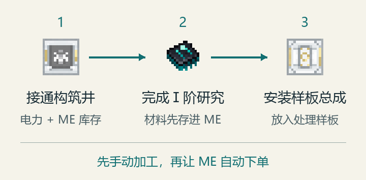
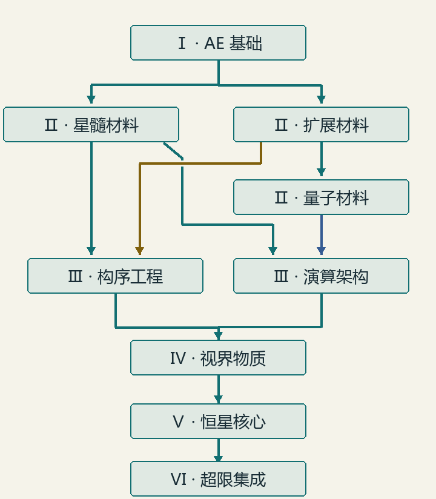

# 万象构序：超限 / OmniSequence: Transfinite

[English](README.md) · [配置参考](CONFIGURATION.md) · [作者与接口文档](docs/README.md)

这是一个帮助你扩建 AE2、ExtendedAE 自动化基地的附属模组。先用**物质构筑井**研究和加工材料，再用**构序设备**管理配方、自动补货，用**演算核心**承接大型合成任务。后期可建造**九环天体仪**加速同网设备，再用**视界奇点天枢**采集资源、复制物品。

**第一次玩？** 先按下面的说明安装，再搭第一座构筑井。游戏中把鼠标放在背包或 JEI 的物品上，按 AE2 指南键，默认是 **G**；相关方块也能打开对应页面。按 G 没反应时，到**选项 → 控制**检查指南按键。游戏内指南支持简体中文和英文。

## 安装

本分支版本为 **21.3.0.0**，适用于 **Minecraft 1.21.1 / NeoForge**，使用 **Java 21**。从[项目发布页](https://www.curseforge.com/minecraft/mc-mods/omnisequence-transfinite)选择对应的模组 JAR；源码 ZIP 不能直接当模组安装。

| 必需组件 | 本分支对应版本 |
| --- | --- |
| NeoForge | 21.1.220 或更高 |
| AE2 | 以 19.2.18 为参考版本 |
| ExtendedAE | 1.21-2.2.32-neoforge 或更高 |
| LDLib2 | 2.2.18 或更高 |
| AppliedEnhancements | 1.1.2 或更高，单独安装 |

1. 在启动器中准备 Minecraft 1.21.1、NeoForge 和 Java 21。
2. 把本模组与必需模组放入该实例的 `mods/` 文件夹，也要安装这些模组自身的依赖，例如 ExtendedAE 需要的 Glodium。
3. 联机时，**客户端和服务端都要安装**，两端使用相同构建。启动后确认模组已加载。
4. **推荐安装 JEI**，用来查配方、查看建筑预览和材料表。**AdvancedAE 虽不是启动必需项，但默认量子材料、演算及后续研究需要它**；想走完整六阶段路线，请一并安装。

下文介绍默认玩法。整合包可能调整配方和费用，请以当前 JEI、研究页和机器状态为准。编写脚本、输入命令时使用的内部模组 ID 是 `molecularmanipulator`。

<details>
<summary>可选模组兼容版本</summary>

- Neo ECO AE Extension：可选；安装时须为 21.2.10 或更高，两端一致。
- AdvancedAE：加载下限为 1.6.11；其中反应室和量子合成器的配方权限适配**仅针对 1.6.12-1.21.1**。
- ExtendedAE Plus：新增的自动供应器选择、构筑井上传兼容**仅针对 1.6.4.1**。
- Data Energistics：数字存储仓的容量模拟修正**仅针对 3.3.0 和 3.3.5**，不会扩大实际容量。
- ExpandedAE **2.1.1 不兼容**，其样板供应器修改与本模组冲突。

这些模组不需要全部安装。[作者文档](docs/README.md)保留各项兼容的具体范围。

</details>

## 从零接网，到第一座自动加工井



先准备一套有电的 **ME 网络**：AE2 电缆、物品存储和终端。研究从这套网络取材料，不读取玩家背包。若要自动下单备料，还需要对应样板、原料和空闲的合成 CPU。

1. **用基础 AE2 材料制作物质构筑井控制器。** 不需要先买星算研究。预留 **41×41 格、27 格高**的空间，打开控制器，开启**投影**，按材料表备料后点击**搭建**。建材可放背包或相连的 ME 存储，JEI 可查看完整结构。
2. **接上 ME 和电力。** 确认界面显示结构成型、网络在线。初期手动加工使用物品／流体输入输出口；按 G 查看它们能装在哪些服务位置。
3. **完成Ⅰ阶：AE 基础构筑。** 打开**研究**页，选中分支，将清单材料存入 ME。材料齐全后启动，也可点击**下单**自动准备缺料。首轮解锁 AE 加工、样板总成和分子自动合成器。
4. **装上样板总成。** 为构筑井配方编码处理样板，放进总成，就能接收 ME 合成任务。从 JEI 上传井配方会消耗编码终端里的一张空白样板；本地槽为空时从相连 ME 存储提取。记得给产物留下存储空间。
5. **按下一节选择你需要的设备。** 通过Ⅱ阶材料研究，推进Ⅲ阶构序和演算分支；不必把所有研究都做到九轮才进入下一阶。

### 研究怎么走



| 阶段 | 主要开放内容 |
| --- | --- |
| Ⅰ：AE 基础构筑 | 基础 AE 工艺、样板总成、分子自动合成器 |
| Ⅱ：星髓／扩展／量子材料工程 | 后续设备所需材料；量子材料需要 AdvancedAE |
| Ⅲ：构序工程／演算架构 | 构序设备与合成 CPU 结构 |
| Ⅳ → Ⅴ → Ⅵ：视界物质 → 恒星核心 → 超限集成工程 | 黑白洞与天枢结构，再到天枢主控，最后是超限算枢 |

普通前置通常只需**完成一轮**。联动机器研究例外：**两条Ⅲ阶研究各累计完成三轮**，首轮也计入。这类研究把其他机器的受支持配方导入构筑井；Ⅱ阶固定材料工艺不受这个三轮条件限制。

每项内置研究都有**九轮**。首轮解锁配方，后续提高一批能加工的份数；实际仍要有足够原料、电力和输出空间。普通下单准备下一轮，**Shift 下单**准备所有剩余轮次，并在一次研究后直接到满阶。备料可以取消，**下单研究正式开始后不能停止或暂停**。

另有两条可选支线：Ⅰ阶后可研究**异态物质学**，获得幽灵物质与引力水晶；星髓材料后可研究**星讯诱导结晶**，消耗水和星讯流增殖水晶，无瑕母岩作为催化剂保留。生产加速来自同一 ME 网络的星算引擎，不来自追加研究轮数；内置构筑配方未加速前通常为 20 秒，研究本身另行计时。

## 我的问题该用什么设备解决？

| 想做什么 | 选什么 |
| --- | --- |
| 研究、加工材料 | **物质构筑井**；加装**样板总成**后接入 ME 自动合成 |
| 保存大量样板，同时维持多种成品库存 | **构序阵列**：大容量样板库、九个独立补货位置 |
| 用一格机器批量合成、锻造、切石 | **分子构序重写阵列**：360 个样板槽；除井内研究外还需单方块集成许可 |
| 让 ExtendedAE 装配矩阵批量执行配方 | **装配矩阵构序重写核心** |
| 保留一部分原料，并持续补齐指定成品 | **分子自动合成器** |
| 承接大型 ME 合成订单 | **万物演算核心**；高阶星算增益可开启并发请求 |
| 把合成 CPU 缩成一格 | **超限算枢**：需要一个频道、充足 ME 供电，以及两套研究条件 |
| 加速同一 ME 网络中的设备 | **星算引擎**，使用**九环天体仪**结构 |
| 生产星讯流 | **星海解算主楼**，配合星讯存储元件 |
| 批量采集原材料或复制样品 | **视界奇点天枢**；**单方块奇点天枢**是创造模式／命令替代品 |
| 传送掉落物或非玩家生物 | **微型黑洞／白洞**，送往同队最近出口 |
| 沿墙、天花板行走或搭建升降通道 | **引力水晶**；**幽灵物质**是可用水抑制的危险物质，也作保留催化剂 |
| 手提绿火照明，在个人模拟中取得无瑕母岩 | **模拟灯笼** |

构序阵列的**自动上传**会接收同网络原生 AE2 终端中新编码的合成、锻造和切石样板，默认**关闭**。**一键迁移样板**只在点击时搬入公开槽位和在线存储盘中的已有实体样板；处理样板不搬，满库时剩余样板留在来源，物品及组件原样保留。

## 九环天体仪：先获得加速，L3 再解锁单方块许可

星算引擎**不是独立的 3×3×3 机器**。即使只做 L0，也必须同时有：

- **中央 27 件**：1 个主核、22 个外壳、4 个观测端口；四个水平面的中央各放一个端口。
- 按指定位置摆好的 **928 个基座**：520 个雕纹基座、408 个鎏金基座。

建议查看 JEI 的**天体仪结构**预览，或直接订购完整的**天体仪 L1／L2／L3 包裹**。每包都含完整中央、基座与前 1／2／3 环，总计 **979／1011／1051 件**。部署时，核心在所选基面上方 37 格。

打开**升级**页，按清单准备星位锚。正确位置已有的锚计入数量，只取缺少的材料，先背包、后本机所在的有电 ME 网络。L1／L2／L3 累计使用 **24／56／96 个基准星位锚**；L4–L9 须逐级点击升级。默认**没有额外升级能量、任务或研究付款**，完成一级不会自动开始下一级。内环缺件会降低实际可用等级；堆叠引擎不会叠加加速收益。

到**实际 L3**后，打开**配方树**，选中**单方块集成**，再**点击解锁**。这是**唯一默认星算研究**，费用 **0 bit**、**无前置**，免费也必须主动解锁。引擎须成型、ME 在线，并绑定本队。

这份团队永久许可默认只限制**分子构序重写阵列**和**超限算枢**两条单方块配方，仍须完成各自井内研究、付出配方材料。**物质构筑井、构序阵列和万物演算核心的多方块控制器没有默认星算研究锁**。整合包可以追加规则；旧存档已买进度继续保留。稳定 ID、存档迁移及自定义规则见[星算研究参考](docs/star-research-nodes.zh-CN.md)。

### 需要星讯流时怎么做？

把**星海解算主楼**放在平整的 5×5 地基上，上方留空 9 格。电缆连接**底座正面最底层中央的白色端口**，提供一个频道，并在 ME 存储中装入**星讯存储元件**。普通维度须有天空光、时间不固定且处于夜间；离讯之境也可运行。屋顶正上方 25 个位置的光照都要 **≤7**。空手右键建筑可查看当前卡在哪个条件。

默认每个有效本地工作刻消耗 **1024 AE**，产出 **128 bit**。离讯之境在相同每刻费用下提供 **8 倍产出**，该维度变化的时间速度另外影响每秒工作次数。星讯流用于可选超频和水晶增殖；免费 L3 研究不要求星讯余额。

**存储元件**是有序工作台配方，不要与放在中央的**存储组件**混淆：

| 左列 | 中列 | 右列 |
| --- | --- | --- |
| 聚能石英玻璃 | 星髓晶粉 | 聚能石英玻璃 |
| 星髓晶粉 | 星讯存储组件 | 星髓晶粉 |
| 星髓合金锭 | 星图处理器 | 星髓合金锭 |

## 整座建筑怎么搭、怎么搬？

先认这三个游戏内物品图标：

|  |  |  |
| --- | --- | --- |
| **包裹**：带着一整座建筑走 | **定标器**：预览位置、展开建筑 | **访问终端**：远程打开已建机器 |

1. 将**空间折叠装配器**接入 ME，终端中会出现物质构筑井、构序阵列、万物演算核心、视界奇点天枢和天体仪 L1／L2／L3，共七种可合成的完整包裹。从 ME 终端下单即可，仍需支付控制器和全部标准建材，并满足原有研究条件。
2. 手持**星图定标器**右键场地，选择包裹、基面和朝向，检查投影冲突后确认。视界奇点天枢须预留 **97×97 格、129 格高**；主控比基面高 65 格，中央光井要求留空的位置也不能堵住。
3. **Esc 只收起面板。** 再次右键重开原定点；要换址，先点**取消定点**。未完成施工用面板中的**中断回收建筑**撤回，不是潜行右键。
4. 搬迁已投入使用的多方块，先完成施工／升级、结清外部 ME 合成任务，再使用机器界面的回收入口。适用于构筑井、构序阵列、多方块演算核心、多方块天枢及已成型天体仪。天枢须先停止采集、让运动部件归位；天体仪档案包按当时实际连续完整的星环生成，包含 L0、L4–L9。

**备份整个世界目录。** 建筑内容保存在 `<世界>/data/molecularmanipulator/buildings/`，包裹只持有引用；只把物品复制到另一存档，并不会带走建筑。旧档案恢复原有内容，不免费补件；旧星算立方体要补齐中央实体与真实天体仪基座才能成型。

**建筑访问终端**可绑定最多 64 座建筑；仅限同维度、目标区块已加载时使用，不会替你加载区块。完整展开与回收步骤请按 G 查看指南。

## 采集、复制与常见卡点

天枢默认每 **20 tick 同时产出列表中每种资源 1000 个**。物质复制页最多放 **64 个微型黑洞**，每个每 20 tick 生产 **20 mB 奇点序质**；每 mB 消耗 **1000 FE 或 256 AE**。复制一件物品使用 **1000 mB**，样品保留。需要 **ME 流体空间**存序质、**ME 物品空间**收产物；大容量存储不等于有供电。

黑白洞在放置时绑定 FTB 队伍，未安装 FTB Teams 时绑定个人；换队后重新放置。白洞保持自身区块加载，黑洞须处在已加载区块才能工作。

| 现象 | 先检查什么 |
| --- | --- |
| 结构不能成型 | 投影、缺块／错材质、障碍、区块加载 |
| 研究不能开始 | 材料是否在该井 ME 存储、前置完成次数、电力、待退款 |
| 配方提示需要研究 | 井内所属研究；两种单方块设备还需手动解锁 L3 单方块集成 |
| 加工停止 | 网络供电与频道、原料、催化剂、产物空间 |
| 大型特效掉帧 | 机器**特效**按钮：0 关、1 精简、2 完整；Shift 点击恢复客户端默认 |

## 配置与作者参考

一般玩家可以直接使用默认配置。服主可在 `config/omnisequence-transfinite-server.toml` 调整耗电、样板容量、采集列表、产量和区块加载；渲染档位在 `config/omnisequence-transfinite-client.toml`。它们是实例级文件，不在每个世界的 `serverconfig/` 中。修改后保存并重启，详见[配置参考](CONFIGURATION.md)。

**整合包／模组作者：** [docs/README.md](docs/README.md) 提供配方与研究格式、KubeJS 示例、全局配方权限、天体仪升级规则及 Java 供应器接口。普通玩家无需编写这些接口。

### 从源码构建——开发者用

使用 Java 21，按 [libs/README.md](libs/README.md) 准备本地依赖，包括 `appliedenhancements-1.1.4.jar` 与可选模组的编译接口 JAR，然后运行：

```sh
./gradlew build apiJavadoc
```

Windows 使用 `gradlew.bat build apiJavadoc`。运行产物为 `build/libs/omnisequence-transfinite-21.3.0.0.jar`，Java API 文档位于 `build/docs/api/`。

界面使用 Minecraft 默认字体，不随附字体文件。代码使用 [MIT 许可证](LICENSE)，改编的 AE2 贴图保留 CC BY-NC-SA 3.0；详见[第三方声明](THIRD_PARTY_NOTICES.md)。
