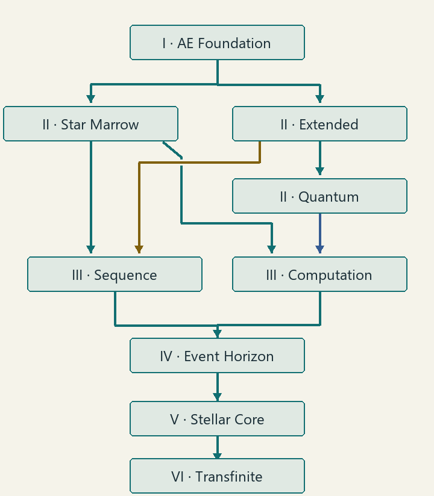

---
navigation:
  parent: items-blocks-machines/matter_fabrication_well.md
  title: "Fabrication Research"
  icon: ae2:engineering_processor
  position: 0
---

# Fabrication Research

Research unlocks new Fabrication Well recipes; repeating a research lets that branch process more recipe executions together.

<Row>
<ItemImage id="ae2:engineering_processor" scale="4" />

<ItemImage id="molecularmanipulator:star_marrow_crystal" scale="4" />

<ItemImage id="molecularmanipulator:star_chart_processor" scale="4" />
</Row>

## Before you start

- Build a complete [Fabrication Well](matter_fabrication_well.md) and connect powered ME storage.
- **Put research materials in that ME network. The well does not take them from your backpack or input ports.**
- Research belongs to this well. A second well needs its own completions.
- Start with **Tier I: AE Foundation**. Its first round needs **4 Inscribers, 4 Chargers, 256 Certus Quartz Crystals, 128 Fluix Crystals, and 64 each of Logic, Calculation and Engineering Processors**.

## Complete your first research

1. Open the controller and select **Study**.
2. Select **Tier I: AE Foundation** in the project list. Read **Stock / round cost** and the listed prerequisites. Scroll the material list to see every requirement.
3. Store the full cost in ME, then select **Unlock**. All materials for this round are paid at the start.
4. Keep the structure, network and power available. The first round takes **30 seconds at 256 AE/t** by default.
5. Look for **1 / 9 completions**. You can now make a [Pattern Assembly](matter_fabrication_pattern_assembly.md) and use the unlocked AE processing recipes.

For another round, select **Deep research**. Manually started research can be paused with **Pause** and continued with **Resume**, keeping paid materials and progress. Separate branches can run at the same time if you supply enough power.

## Which branch should you choose next?

Follow arrows from prerequisite to next research. Both Tier III branches are needed later. Optional Crystallization and Exotic Matter branches are not pictured.

Unless a count is stated, one completion of each prerequisite is enough. Times and power below are defaults; the research panel shows your pack's current requirements.

| Research | Complete first | What it opens | Time / AE per tick |
| --- | --- | --- | --- |
| I · AE Foundation | Nothing | AE processing, Pattern Assembly, Molecular Auto Crafter | 30 s / 256 |
| II · Star Marrow Materials | AE Foundation | Boards, processors, dust, alloy, signal components and later star anchors | 45 s / 512 |
| II · Extended Materials | AE Foundation | ExtendedAE materials and parts needed for progression | 45 s / 512 |
| II · Quantum Materials | Extended Materials | AdvancedAE materials and parts needed for progression | 60 s / 1024 |
| III · Sequence Engineering | Extended Materials + Star Marrow Materials | Sequence machinery, rewrite devices, Infinite Crafting Storage and Infinite Parallel Matrix | 60 s / 1024 |
| III · Computation Architecture | Quantum Materials + Star Marrow Materials | Computation machinery and Omniscient Computation Matrix | 90 s / 2048 |
| IV · Event Horizon Materials | Sequence Engineering + Computation Architecture | Black/white holes and hub building parts | 90 s / 4096 |
| V · Stellar Cores | Event Horizon Materials | Miniature Supernova, hub controller and White Hole Resource Core | 120 s / 8192 |
| VI · Transfinite Integration | Stellar Cores | Transfinite Compute Nexus | 180 s / 16384 |
| Optional · Signal-Induced Crystallization | Star Marrow Materials | Make crystals from signal and water with a reusable Flawless parent rock | 60 s / 512 |
| Optional · Exotic Matter Studies | AE Foundation | Ghost Matter and Gravity Crystals | 30 s / 256 |

**You can keep using naturally grown crystals.** Signal-Induced Crystallization is optional; basic star-material processing needs neither signal nor a Flawless parent rock.

### Bringing other machines' recipes into the well

Machine-integration research requires **at least three completions of both Tier III branches**: Sequence Engineering **3 / 9** and Computation Architecture **3 / 9**. The first round counts toward three. Merely reaching Tier III is not enough.

This applies to all default machine integrations and pack-added machine imports, including their production recipes. Tier II Extended/Quantum Materials provide the startup recipes needed to reach those branches. Integrations appear when their required mods are installed.

### The separate Star Orrery research

The [Star Computation Engine](star_computation_engine.md) is a **nine-ring Star Orrery**, not a separate small cube. Its default research menu contains only **Single-Block Integration**: reach **L3**, then **actively unlock it for 0 bit**.

That unlock is an additional requirement for the **Molecular Sequence Rewrite Array** and **Transfinite Compute Nexus** only; their well-research requirements still apply. The three matrices, star anchors and Molecular Auto Crafter have no extra star-research unlock in the defaults.

## Let ME prepare the materials

The network needs suitable patterns, ingredients and an available crafting CPU.

| Button | What happens |
| --- | --- |
| **Order** | Prepare the next round, then start research automatically. |
| Hold **Shift** → **Order to Maximum** | Show and prepare the combined cost of every remaining round, then finish them in one research run. |
| **Stop Current Research**, while preparing | Cancel preparation and unfinished material orders; return reserved materials to ME. |

**Once ordered research starts, it cannot be stopped or paused.** Ordering to maximum pays for all remaining rounds but takes one research duration at that branch's listed power. Check the total before ordering. Refunds wait safely if ME storage is full.

## Larger batches: all nine rounds

Every default research has **nine rounds**, including Exotic Matter Studies and machine integrations. The first unlocks recipes. Later rounds increase **parallelism: how many recipe executions can run together**. They do not make one execution faster.

| Completed rounds | Parallel limit |
| --- | --- |
| 1 | 1 |
| 2 | 256 |
| 3 | 65,536 |
| 4 | 16.78M |
| 5 | 4.29G |
| 6 | 1.10T |
| 7 | 281.47T |
| 8 | 72.06P |
| 9 | 9.22E |

Read each next round's material list: expansion rounds use their own costs, not a repeat of the first round's machine purchases. Actual batches still need enough ingredients, power and output space.

Production speed comes from the Star Computation Engine on the controller's ME network. It does not shorten research timers. Basic recipes that need no research remain available and use AE Foundation's completed parallel limit, or one execution before any completion.

## What success looks like

The completed count increases, the branch's recipes become available, and later rounds raise the displayed parallel limit. Use the recipe-unlock list to inspect what that branch produces.

## If it does not work

| Problem | Fix |
| --- | --- |
| Materials are in your inventory but stock is zero | Store them in the controller's ME network, not its ports. |
| Unlock / Deep research is unavailable | Check all prerequisite counts, current ME stock, structure and network. |
| Machine integration stays locked | Complete **both** Tier III branches three times. |
| Material ordering waits | Open **Details**; check missing patterns, ingredients and CPU availability. |
| Research stops advancing | Restore structure, network and sufficient power. Paid materials and progress remain. |
| Array or nexus recipe is still locked | Check both its well research and the L3 **Single-Block Integration** unlock in the Star Orrery. |

## Next steps

Install a [Pattern Assembly](matter_fabrication_pattern_assembly.md), grow [Star Marrow Crystals](star_marrow_crystals.md), or follow [Exotic Matter Studies](nomai_materials.md) for gravity tools.
