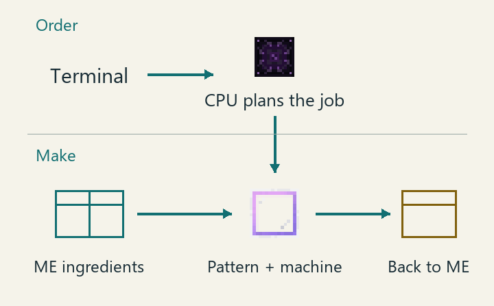

---
navigation:
  parent: omnisequence-index.md
  title: "Omni Computation Core"
  icon: molecularmanipulator:omni_computation_controller
  position: 1020
item_ids:
- molecularmanipulator:omni_computation_controller
- molecularmanipulator:omni_computation_casing
- molecularmanipulator:omni_computation_glass
- molecularmanipulator:infinite_parallel_matrix
- molecularmanipulator:infinite_crafting_storage
- molecularmanipulator:universal_pattern_matrix
- molecularmanipulator:computation_data_entangler
- molecularmanipulator:computation_energy_stabilizer
- molecularmanipulator:computation_output_node
- molecularmanipulator:computation_crystal_pylon
---

# Omni Computation Core

## Purpose: accept ME orders and arrange their crafting steps

The Omni Computation Core is a large **crafting CPU**. After you confirm a terminal order, it arranges the crafting steps, waits for ingredients and collects results. With a high-level Star Computation Engine, one core can also handle multiple independent orders at once.

<Row>
<ItemImage id="ae2:crafting_terminal" scale="4" />
<BlockImage id="molecularmanipulator:omni_computation_controller" scale="4" />
<BlockImage id="molecularmanipulator:molecular_manipulator" scale="4" />
</Row>

Left to right: the terminal places orders, the core manages them, and the rewrite machine makes the items. **Patterns** are encoded recipe cards kept in a Sequence Array, rewrite machine or Pattern Provider. **ME storage** holds ingredients and products. This core is neither a pattern library nor an item warehouse.

This diagram explains roles, not cable placement or building dimensions.

## Prepare

- Complete one round of **Tier III: Computation Architecture** in the [Fabrication Well](matter_fabrication_research.md), then fabricate the controller and structure parts. Some parts also come from the Sequence Engineering route; meet their listed well research requirements. This route uses materials from ExtendedAE and AdvancedAE.
- Clear **65 × 65 blocks, 35 blocks tall**. Facing the controller's front, allow **32 blocks to each side**, **17 above and below**, **22 in front** and **42 behind**. Check the projection after placement.
- An ME network with item storage, a terminal, at least one usable recipe and a machine that actually performs it.
- Enough ME power and **one free channel**, a network connection allowance for a device. Default base idle consumption is **8192 AE/t**, with additional energy needed for crafting.

These are structure parts. Check the full quantities on JEI's structure page, then follow the projection rather than placing a ring of blocks around the controller.

<ItemGrid>
<ItemIcon id="molecularmanipulator:omni_computation_controller" />
<ItemIcon id="molecularmanipulator:omni_computation_casing" />
<ItemIcon id="molecularmanipulator:omni_computation_glass" />
<ItemIcon id="molecularmanipulator:infinite_parallel_matrix" />
<ItemIcon id="molecularmanipulator:infinite_crafting_storage" />
<ItemIcon id="molecularmanipulator:universal_pattern_matrix" />
<ItemIcon id="molecularmanipulator:computation_data_entangler" />
<ItemIcon id="molecularmanipulator:computation_energy_stabilizer" />
<ItemIcon id="molecularmanipulator:computation_output_node" />
<ItemIcon id="molecularmanipulator:computation_crystal_pylon" />
</ItemGrid>

<RecipeFor id="molecularmanipulator:omni_computation_controller" fallbackText="Check JEI for the controller's Fabrication Well recipe and the structure material list." />

## Steps: build it, then request a simple recipe

1. Place the controller, open its interface and enable **Projection**. Clear conflicts and check that the structure fits within world height limits.
2. Gather the JEI material list in your inventory or an ME network connected to the controller. Select **Build**. Materials come from your inventory first, then ME.
3. Wait for construction to finish. Confirm formation and network connection. Put the terminal, ME storage and actual crafting machine on the **same network**.
4. Prepare an “oak log → oak planks” pattern in a rewrite machine or a Sequence Array's main library. Store at least **4 logs** in ME.
5. Request **16 planks** from the terminal. Select the Omni Computation Core as the CPU in crafting confirmation, then confirm.
6. Monitor the order in AE2 Crafting Status and retrieve the products from ME. Do not put ingredients or patterns into the CPU.

## What success looks like

- The crafting confirmation screen offers this core as a CPU; seeing the building alone is not enough.
- The order starts, finishes and returns planks to ME, with the actual crafting machine on the same network.
- A suitable Star Computation Engine raises the core's order-handling capacity.

### “Parallelism 16” does not mean 16 independent orders

**Crafting storage** is workspace for orders, not ME item-storage capacity. **Recipe parallelism** is how much crafting work can advance within orders. How many independent orders can run is a separate limit.

| Star Computation Engine on the same network | Order and work limits |
| --- | --- |
| No active, valid engine | **1 MiB crafting storage and recipe parallelism 16**; one independent order per core. |
| L1–L6, normal operation | Crafting storage and recipe parallelism grow with level; still one independent order. |
| L7–L9, normal operation | Multiple independent orders share the core's crafting storage and work allowance. **Normal L9 still has finite limits.** |
| L9, overclock enabled and continuously paid | Unlimited crafting-storage and recipe-parallelism limits. Actual production still needs ingredients, power, machines and output space. |

L1–L8 overclocking continuously consumes **star signal flow** from the same network and doubles crafting storage and recipe parallelism. It does not unlock multiple orders before L7. If signal flow runs short, overclocking ends and the engine returns to its level's finite normal capabilities. Multiple engines on one network do not multiply benefits; the strongest currently valid engine supplies them.

## Troubleshooting

| What you see | What to do |
| --- | --- |
| The terminal cannot find this CPU | Check formation, same-network connection, power and channel. First make sure you can sustain its base idle consumption. |
| A CPU is available, but the recipe is not | Put its encoded pattern in a Sequence Array, rewrite machine or Pattern Provider. The core does not store recipes. |
| Not enough crafting storage | Split the order, wait for current orders to finish, or raise the connected engine's level. More ordinary storage cells do not enlarge CPU crafting storage. |
| No second order below L7 | This is the single-order stage. Upgrade the effective engine to L7, or add another CPU to the network. |
| An order stalls at an external machine | Check missing ingredients, Pattern Providers and machine input/output. Cyclic recipes also need an initial supply of the ingredient that starts the cycle. |
| Products are made, but the order is waiting | Free space in ME and machine outputs. Check that output returns to the same network, with room for tools and returned containers too. |
| L9 suddenly has finite limits again | Check the overclock switch and star signal flow balance. Reaching L9 does not automatically grant unlimited capabilities. |

External machines work at the rate they can accept. The core adapts to that capacity, and an order's final single craft can run without filling a batch. Supported reusable tools continue into later crafts with normal durability changes, rather than being replaced with new tools.

### When using machines from other mods

- **ECO** autocrafting integration supports **21.2.10 and later**.
- **Data Energistics** Digital Storage Depot free-space handling supports **3.3.0 / 3.3.5**. The depot still needs actual room.
- Research-permission integration for **AdvancedAE** Quantum Crafters and Reaction Chambers targets **1.6.12-1.21.1**. That is the supported integration version for those machines. Fabricating this core requires the AdvancedAE materials in its recipes, not that integration-specific version condition.

## Next steps

For remote networking, put one **Quantum Entangled Singularity** in the quantum slot and its partner in a powered AE2 quantum bridge. The connection needs an additional **512 AE/t and one channel**.

Before relocating, finish or cancel and settle orders, then use **Reclaim Package** to pack the whole machine. See [Folded Buildings and Relocation](folded_buildings.md). Structure damage or chunk unloading retains tasks and materials; restore operating conditions to continue. When enabled by the server, multiblock chunk loading keeps the required operation and construction chunks loaded.

For the same CPU functions in one block, continue to the [Transfinite Compute Nexus](transfinite_compute_nexus.md). To keep supplies stocked without terminal orders, use a [Molecular Auto Crafter](molecular_auto_crafter.md).
