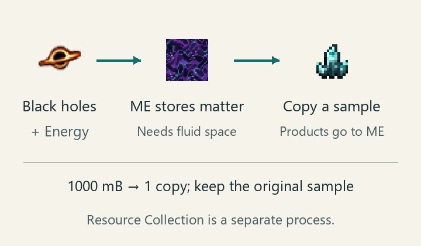

---
navigation:
  parent: items-blocks-machines/event_horizon_singularity_hub.md
  title: "Singularity Matter Duplication"
  icon: molecularmanipulator:singularity_sequence_matter_bucket
  position: 1
item_ids:
- molecularmanipulator:singularity_sequence_matter_bucket
---

# Singularity Matter Duplication

Use miniature black holes and energy to generate Sequence Matter, then spend that fluid to copy a sample item. The original stays in the sample slot and copies go directly into ME. Resource Collection runs separately.

<Row>
<ItemImage id="molecularmanipulator:black_hole" scale="5" />

<ItemImage id="molecularmanipulator:singularity_sequence_matter_bucket" scale="5" />

<ItemImage id="minecraft:diamond" scale="5" />
</Row>

Left to right: a Miniature Black Hole, Sequence Matter fluid and an example sample. The bucket identifies the fluid; keep buckets out of the hub's slots.

The crystal in the diagram is another example sample. Put the item you want to copy in the sample slot.

## Requirements

- A formed [Event Horizon Singularity Hub](event_horizon_singularity_hub.md), or a connected [Compact Hub](compact_singularity_hub.md).
- An online ME network with fluid storage for matter and item storage for copies. Check that infinite storage supports fluids too.
- At least one [Miniature Black Hole](black_and_white_holes.md), energy for generation and a sample to copy. If you already have stored matter, you can copy without installing black holes.

## Generate matter

1. Open Matter Duplication on the hub.
2. Insert up to 64 miniature black holes in the Matter generator slot. Keep them out of Overview's quantum slot.
3. Supply FE from adjacent energy devices or AE from the ME network, as described below. Leave ME fluid capacity available.
4. Keep the sample slot empty while building a matter reserve. Generation starts automatically, and Sequence Matter appears in ME after each cycle. Start Collection is not required.

The default cycle is 20 ticks, about 1 second at normal speed.

| Black holes | Matter per cycle |
| --- | --- |
| 1 | 20 mB |
| 16 | 320 mB |
| 64 | 1280 mB |

Black holes are retained. Adding more raises generation capacity and energy cost, while each copy still costs the same amount of matter.

### FE and AE power

The default priority is FE, then AE. The hub extracts FE from energy-extractable devices adjacent to any of the controller's six faces. AE comes from the connected ME network. ME must stay powered and online even when FE pays for generation.

| Using this energy alone | Per 1 mB generated | Full cycle with 1 black hole (20 mB) |
| --- | --- | --- |
| FE | 1000 FE | 20,000 FE |
| AE | 256 AE | 5120 AE |

A cycle uses one energy source. If FE can pay for only 10 mB, it produces 10 mB without drawing AE to reach 20 mB. The hub tries AE only when it cannot draw any FE. A trace of FE below the cost of 1 mB produces nothing that cycle.

The interface shows both energy costs and the previous cycle's actual use separately. Servers can change priority, costs, output and interval; use the displayed values for your world.

## Copy a sample item

1. Store at least 1000 mB, or 1 bucket, of matter in ME and leave item space for copies.
2. Put the target item in the sample slot. The hub draws fluid directly from ME storage.
3. Collect the copies from ME. Each costs 1000 mB and preserves item details such as names and enchantments. The original stays in its slot.
4. Remove the sample to stop copying. Remove the black holes to stop generation. Stop Collection affects neither function.

Copying can use matter as fast as you generate it, so a steady fluid count can still mean generation is working. Remove the sample to let the reserve build again.

With enough matter and item space, copying is limited to 1 item per tick. By default, 64 black holes generate 1280 mB per second, enough for an average of about 1.28 copies per second. A stored reserve can support faster copying temporarily. More black holes cannot raise the per-tick limit, and collection speed settings do not affect copying.

Servers may prohibit copying certain items; none are blocked by default. A prohibited sample remains retrievable and spends no matter. Generation and Resource Collection continue independently.

If ME temporarily cannot accept delivery, completed copies and matter awaiting refund are retained until the network recovers.

## Troubleshooting

| Problem | What to check |
| --- | --- |
| Item space is available but matter stays at zero | Provide ME fluid storage that accepts matter, black holes and enough energy. |
| Very little FE, but ample AE is not taking over | A cycle uses one source. Supply enough FE, disconnect the FE source so AE takes over, or ask the server owner to change priority. |
| Fluid stock never rises | Remove the sample; copying may be spending newly generated matter. |
| Sample inserted, but no copies | Check for 1000 mB of matter, ME item space and server copying restrictions. |
| Energy use continues after stopping collection | Remove the black holes to stop matter generation. |

Select Guide on the machine's duplication page to return here.
