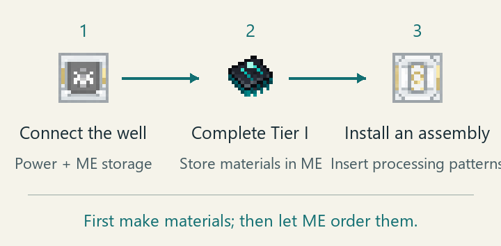
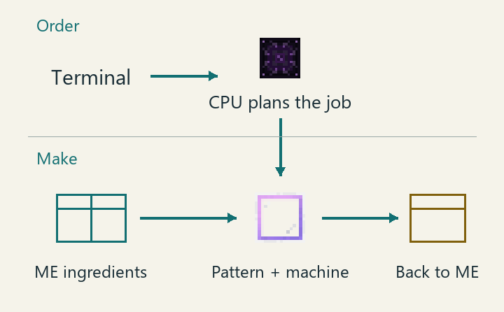

---
navigation:
  title: "OmniSequence: Transfinite"
  icon: molecularmanipulator:matter_fabrication_controller
  position: 80
---

# OmniSequence: Transfinite

Start with one Matter Fabrication Well. Use it to research materials, then add machines for batch crafting and automatic restocking.

## Getting started

1. Connect ME power, cable, storage and a terminal, then store your ingredients. New to AE2? Start with [AE2 Getting Started](ae2:getting-started.md).
2. Craft a Matter Fabrication Well controller and reserve 41×41 blocks, 27 blocks high. Check the site with its projection, gather the listed materials and build. Confirm that it is formed and ME-online. [Build your first well](items-blocks-machines/matter_fabrication_well.md).
3. Complete Tier I: AE Foundation. Check the research cost, store materials in the connected ME network and start research. Your inventory and input ports do not supply research materials. [First research steps](items-blocks-machines/matter_fabrication_research.md).
4. Install a Pattern Assembly, encode processing patterns for well recipes and insert them. ME orders also need ingredients, an available crafting CPU and space for output. [Use a Pattern Assembly](items-blocks-machines/matter_fabrication_pattern_assembly.md).

One research round unlocks a branch's recipes; later rounds increase batch size. AdvancedAE is optional for launching the mod, but default Quantum Materials, Computation and later research need it for the full route.

## Patterns, CPUs and storage

- ME storage holds ingredients and products.
- A pattern records a recipe's inputs and outputs. Make it in a Pattern Encoding Terminal. Each machine accepts particular pattern types.
- A crafting CPU accepts orders and arranges their steps. You still need ingredients and a machine to perform each recipe.
- A channel allows a device to connect to ME. A cabled machine may be offline if it has no channel.

Each machine's page shows its layout and connections. The Sequence Array stores patterns and performs recipes in the same building.

## Choose a machine

<Row>
<BlockImage id="molecularmanipulator:matter_fabrication_controller" scale="4" />

<BlockImage id="molecularmanipulator:molecular_center_controller" scale="4" />

<BlockImage id="molecularmanipulator:omni_computation_controller" scale="4" />

<BlockImage id="molecularmanipulator:event_horizon_singularity_hub" scale="4" />
</Row>

Left to right: well, Sequence Array, computation core and Singularity Hub controllers. Build the machines you need; they have different jobs and no required replacement order.

| Your goal | Read this |
| --- | --- |
| Research and process new materials | [Fabrication Well](items-blocks-machines/matter_fabrication_well.md), [Research route](items-blocks-machines/matter_fabrication_research.md) |
| Pipe items/fluids or encode a well recipe from JEI | [Input and Output Ports](items-blocks-machines/matter_fabrication_ports.md), [Pattern Assembly](items-blocks-machines/matter_fabrication_pattern_assembly.md) |
| Store many patterns and keep products stocked | [Sequence Array](items-blocks-machines/sequence_array_controller.md), [Molecular Auto Crafter](items-blocks-machines/molecular_auto_crafter.md) |
| Craft, smith and stonecut in batches from one block | [Molecular Sequence Rewrite Array](items-blocks-machines/molecular_sequence_rewrite_array.md) |
| Add batch crafting to an ExtendedAE Assembler Matrix | [Matrix Rewrite Core](items-blocks-machines/assembler_matrix_sequence_rewrite_core.md) |
| Accept larger orders, and multiple orders later | [Omni Computation Core](items-blocks-machines/omni_computation_core.md), [Transfinite Compute Nexus](items-blocks-machines/transfinite_compute_nexus.md) |
| Boost machines on the same network | [Star Computation Engine: Nine-Ring Orrery](items-blocks-machines/star_computation_engine.md) |
| Grow crystals, produce and store Star Signal Flow | [Star Marrow Crystals](items-blocks-machines/star_marrow_crystals.md), [Star Sea Calculation Mainframe](items-blocks-machines/star_sea_calculation_mainframe.md), [Signal Storage](items-blocks-machines/star_signal_flow.md) |
| Generate raw materials or copy a sample item | [Singularity Hub](items-blocks-machines/event_horizon_singularity_hub.md), [Resource Collection](items-blocks-machines/singularity_resource_collection.md), [Matter Duplication](items-blocks-machines/singularity_matter_duplication.md) |
| Try the hub in a small creative-mode machine | [Compact Singularity Hub](items-blocks-machines/compact_singularity_hub.md) |
| Connect supported machines to a distant ME network | [Sequence Wireless Hub](items-blocks-machines/sequence_array_controller.md) |
| Transfer dropped items and non-player creatures | [Black and White Holes](items-blocks-machines/black_and_white_holes.md) |
| Deploy a whole building or move a working machine | [Folded Buildings and Relocation](items-blocks-machines/folded_buildings.md), [Building Access Terminal](items-blocks-machines/building_access_terminal.md) |
| Walk on walls, make lifts or explore a personal simulation | [Gravity Crystals and Ghost Matter](items-blocks-machines/nomai_materials.md), [Simulation Lantern](items-blocks-machines/simulation_lantern.md) |

## Well research and star research

Well research unlocks processes for that well. Later rounds let it process more copies of a recipe together. Machine integration research requires three rounds of both Tier III branches. Crystallization and Exotic Matter are optional branches.

Star research grants team permissions. Build the orrery's complete 3×3×3 center and foundation, reach L3, then click Unlock for Single-Block Integration on Recipe Tree. It costs 0 bit. By default, only the Rewrite Array and Compute Nexus require that additional permission.

## Open the guide in game

Hover an item in your inventory or JEI and press the guide key, G by default. Related blocks also have guide entries. Click item pictures for descriptions and recipes, and drag structure diagrams to rotate them. If G does nothing, check its binding under Options, Controls.

Packs can change costs and requirements. Check JEI, research screens and machine status for your world's rules. If a machine stops, use its troubleshooting table.

<SubPages icons={true} />
